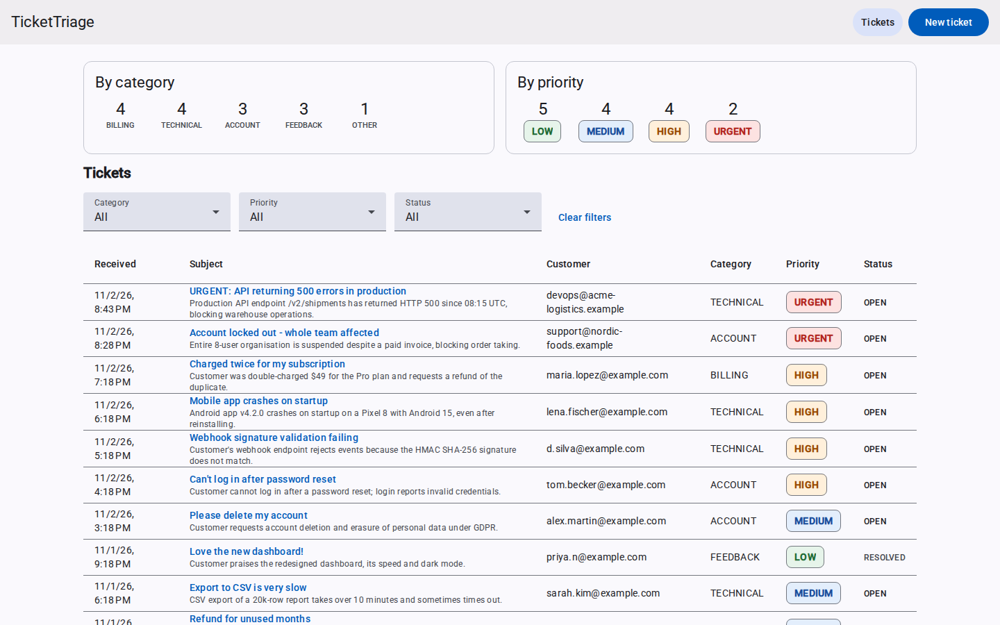
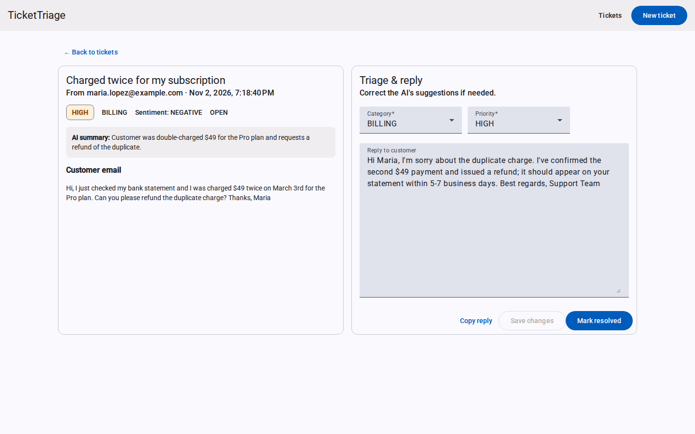
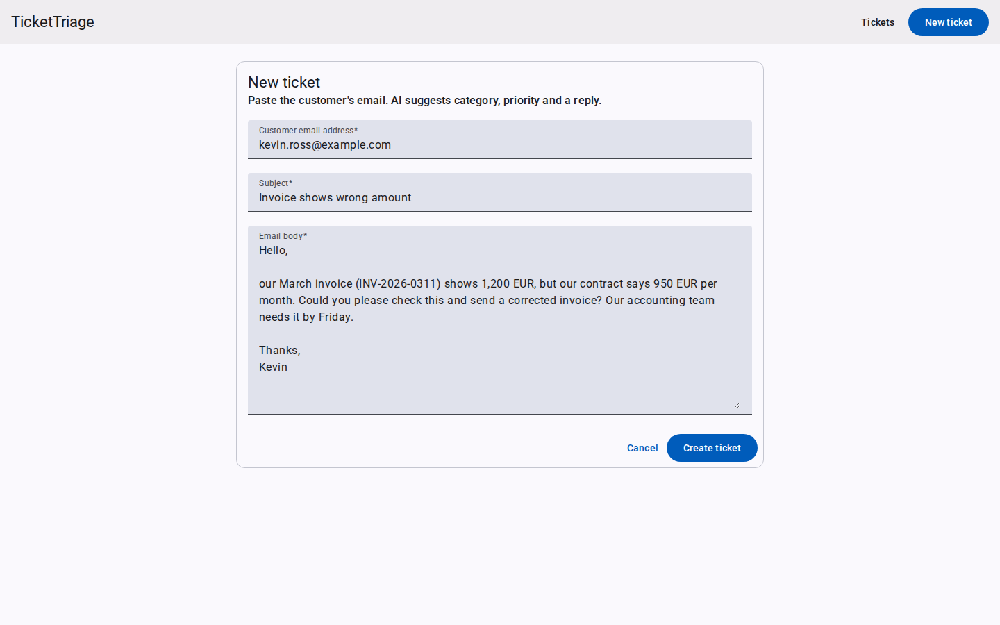
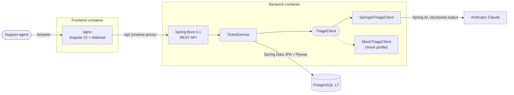
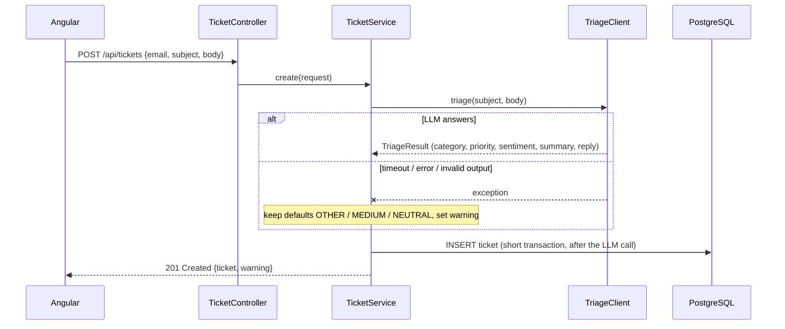

# TicketTriage

[](https://github.com/stanojab/TicketTracker/actions/workflows/ci.yml)


AI-assisted triage for customer support emails. A support agent pastes an email. An LLM classifies it, rates its
urgency, summarises it and drafts a reply. The agent stays in control: they can correct the classification, edit the
reply and resolve the ticket.

## The business problem

Support teams lose time on **sorting** before they can start **solving**. Every incoming email has to be read,
categorised (billing? bug? account?), prioritised and routed, and urgent issues such as outages or locked-out customers
can sit in the queue behind routine questions.

TicketTriage automates that first pass:

- **Category, priority and sentiment** are assigned in seconds, so urgent tickets surface immediately.
- **A one-sentence summary** lets agents scan the queue without opening every email.
- **A suggested reply** gives agents a first draft that they review and edit, not send blindly.
- **Human in the loop:** the AI suggests, the agent decides. Any field can be corrected.
- **Resilient by design:** if the AI provider is down, the ticket is still saved (as OTHER / MEDIUM) with a visible
  warning. Customer emails are never lost.

## Screenshots

**Ticket queue:** stats, filters and color-coded priorities, with urgent issues on top of the list.



**Ticket detail:** the AI's category, priority, sentiment, summary and draft reply, all editable by the agent.



**New ticket:** paste a customer email and the backend triages it.



## Architecture



Creating a ticket, including the fallback:



## Tech stack

| Layer | Technology |
|---|---|
| Backend | Java 21, Spring Boot 4.1 (Web MVC, Data JPA, Validation, Actuator), Flyway, springdoc-openapi |
| AI | Spring AI 2.0 with Anthropic Claude (`claude-opus-5-5` by default, configurable); native structured output mapped to a Java record |
| Database | PostgreSQL 17 |
| Frontend | Angular 22 (standalone components, signals, reactive forms, zoneless), Angular Material 3 |
| Tests | JUnit 5, Mockito, AssertJ, MockMvc, Testcontainers; Vitest for Angular |
| Delivery | Docker multi-stage builds, Docker Compose, GitHub Actions, Azure Container Apps + Azure Database for PostgreSQL |

## Quick start (Docker Compose)

Requires only Docker.

```bash
git clone https://github.com/stanojab/TicketTracker.git
cd TicketTracker
docker compose up --build
```

| What | URL |
|---|---|
| App | http://localhost:8081 |
| Swagger UI | http://localhost:8090/swagger-ui.html |
| PostgreSQL | `localhost:5433` (user / password / db: `tickettriage`) |

By default the stack runs in **mock mode** (`dev,mock` profiles). It loads 15 realistic sample tickets and uses a
keyword-based classifier, so **no API key is needed**. To see the fallback, create a ticket whose body contains
`simulate-ai-failure`.

### Using real AI triage

```bash
cp .env.example .env
# in .env:  SPRING_PROFILES_ACTIVE=dev
#           ANTHROPIC_API_KEY=sk-ant-...
#           ANTHROPIC_MODEL=claude-opus-5-5   (or claude-haiku-5-5 for lower cost)
docker compose up --build
```

`.env` is git-ignored. Never commit API keys.

## Local development (without Docker for the apps)

Requires JDK 21 and Node 24.

```bash
docker compose up -d db                                         # just PostgreSQL

cd backend
./mvnw spring-boot:run -Dspring-boot.run.profiles=dev,mock      # API on http://localhost:8080

cd ../frontend
npm ci
npm start                                                       # UI on http://localhost:4200, /api proxied to :8080
```

## API

| Method | Path | Description |
|---|---|---|
| `POST` | `/api/tickets` | Create a ticket and triage it with AI. Returns `201` with `{ ticket, warning }` |
| `GET` | `/api/tickets?category=&priority=&status=` | List tickets, newest first; all filters optional |
| `GET` | `/api/tickets/{id}` | One ticket |
| `PATCH` | `/api/tickets/{id}` | Update any of `category`, `priority`, `suggestedReply`, `status` |
| `GET` | `/api/stats` | Ticket counts by category and by priority (SQL `GROUP BY`) |

Errors use RFC 9457 **Problem Details**, e.g. `404 {"title":"Ticket not found","detail":"Ticket 99 not found",...}`.
Validation errors include a field → message map in `errors`.

## Tests

```bash
cd backend  && ./mvnw verify                  # needs Docker (Testcontainers starts PostgreSQL)
cd frontend && npm test -- --watch=false
```

- **Service unit tests** (Mockito): triage applied, fallback on failure, partial updates, stats.
- **API integration tests** (MockMvc + Testcontainers PostgreSQL, mock profile): the full HTTP → DB flow.
- **Spring AI integration test**: the *real* Spring AI client against a fake Anthropic HTTP server. It checks request
  building, structured-output parsing and the fallback, with no API key and no cost.
- **Angular unit tests** (Vitest): HTTP service, form validation and submit, components.

CI ([`.github/workflows/ci.yml`](.github/workflows/ci.yml)) runs all of them and builds both Docker images on every push
and pull request.

## Project structure

```
backend/                     Spring Boot API
  src/main/java/com/tickettriage/
    ticket/                  entity, repository, service, controllers, DTOs
    triage/                  TriageClient + Spring AI and mock implementations
    common/                  global exception handling
  src/main/resources/
    db/migration/            Flyway schema migrations
    db/seed/                 sample data (dev profile only)
frontend/                    Angular app (+ nginx config for production)
docs/
  DEPLOYMENT.md              step-by-step Azure deployment with the az CLI
  LEARNING.md                concepts behind each part of the project
docker-compose.yml           full local stack
```

## Key design decisions

- **Layered backend** (controller → service → repository) with DTO records kept separate from the JPA entity.
- **Flyway owns the schema**; Hibernate only validates it (`ddl-auto=validate`).
- **The LLM call runs outside the DB transaction**, so a slow AI response never holds a database connection.
- **LLM output is treated as untrusted input**: it's schema-constrained, validated, length-limited, and the email is
  wrapped in delimiters as a prompt-injection guard.
- **Profiles choose the triage implementation** (`mock` vs real), so dev, tests and CI need no API key.
- **Same-origin API** through the Angular dev proxy and nginx, so no CORS configuration is needed.

## Deployment

See [docs/DEPLOYMENT.md](docs/DEPLOYMENT.md) for deploying to **Azure Container Apps** with **Azure Database for
PostgreSQL Flexible Server**, step by step with the Azure CLI.
