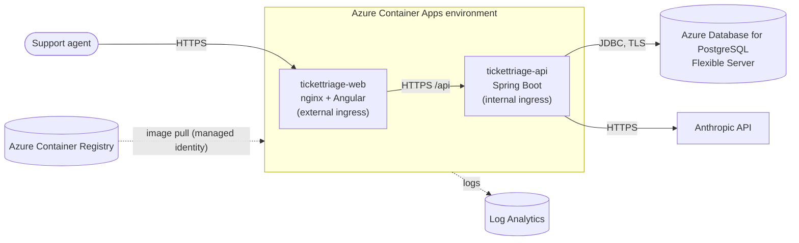

# Deploying TicketTriage to Azure

Target architecture:



| Azure resource | Purpose |
|---|---|
| Resource group | One container for everything, so cleanup is a single delete |
| Azure Container Registry (Basic) | Private registry for the two Docker images |
| Container Apps environment | Shared network and logging boundary for the apps; creates a Log Analytics workspace |
| Container App `tickettriage-api` | Spring Boot backend, **internal** ingress only (not reachable from the internet) |
| Container App `tickettriage-web` | nginx serving Angular and proxying `/api` to the backend, **external** ingress (public HTTPS URL) |
| PostgreSQL Flexible Server (Burstable B1ms) | Managed PostgreSQL 17 |

> ⚠️ **The app has no login.** Anyone with the public URL can read and change tickets. Only use fake data in a demo
> deployment, or enable Container Apps built-in authentication (Microsoft Entra ID) on `tickettriage-web` (see
> [Next steps](#next-steps-for-a-production-setup)).

## Prerequisites

- An Azure subscription, and the [Azure CLI](https://learn.microsoft.com/cli/azure/install-azure-cli) 2.60+
- Docker (to build and push the images)
- A shell that runs bash: Git Bash, WSL, macOS/Linux, or Azure Cloud Shell. The commands below use bash syntax.
- Optional: an Anthropic API key. Without one, deploy in mock mode (step 5, option B).

Run all commands from the repository root.

## 1. Sign in and prepare the subscription

```bash
az login
az account show --query "{name:name, id:id}" -o table   # check that this is the subscription you want

az extension add --name containerapp --upgrade
az provider register --namespace Microsoft.App
az provider register --namespace Microsoft.OperationalInsights
az provider register --namespace Microsoft.ContainerRegistry
az provider register --namespace Microsoft.DBforPostgreSQL
```

## 2. Choose names and settings

```bash
RG=rg-tickettriage
LOCATION=westeurope                        # any region that offers Container Apps + PostgreSQL Flexible Server
SUFFIX=$RANDOM                             # registry and DB server names must be globally unique
ACR=tickettriage$SUFFIX                    # letters and digits only
PG_SERVER=tickettriage-db-$SUFFIX
PG_ADMIN=ttadmin
ENV=tickettriage-env
API_APP=tickettriage-api
WEB_APP=tickettriage-web

read -rsp "PostgreSQL admin password: " PG_PASSWORD; echo
read -rsp "Anthropic API key (empty for mock mode): " ANTHROPIC_API_KEY; echo
```

`read -s` keeps the secrets out of your shell history. Never put them in a file in this repository.

## 3. Resource group and container registry

```bash
az group create --name $RG --location $LOCATION

az acr create --resource-group $RG --name $ACR --sku Basic
ACR_SERVER=$(az acr show --name $ACR --query loginServer -o tsv)
```

## 4. Build and push the images

```bash
az acr login --name $ACR

# --platform: Container Apps runs linux/amd64 (needed when building on an Apple Silicon Mac)
docker build --platform linux/amd64 -t $ACR_SERVER/tickettriage-backend:v1 ./backend
docker build --platform linux/amd64 -t $ACR_SERVER/tickettriage-frontend:v1 ./frontend

docker push $ACR_SERVER/tickettriage-backend:v1
docker push $ACR_SERVER/tickettriage-frontend:v1
```

## 5. PostgreSQL Flexible Server

```bash
az postgres flexible-server create \
  --resource-group $RG --name $PG_SERVER --location $LOCATION \
  --tier Burstable --sku-name Standard_B1ms --storage-size 32 --version 17 \
  --admin-user $PG_ADMIN --admin-password "$PG_PASSWORD" \
  --public-access 0.0.0.0 \
  --yes

az postgres flexible-server db create \
  --resource-group $RG --server-name $PG_SERVER --database-name tickettriage
```

`--public-access 0.0.0.0` adds a firewall rule that allows connections **from Azure services only**, not from the
internet. For a stricter setup, see [Next steps](#next-steps-for-a-production-setup).

You don't need to create any tables: **Flyway** runs the migrations when the backend starts.

## 6. Container Apps environment

```bash
az containerapp env create --name $ENV --resource-group $RG --location $LOCATION
```

## 7. Backend Container App (internal)

Secrets are stored in the Container App and referenced from env vars with `secretref:`, so they never appear
in plain text in the app configuration.

```bash
DB_URL="jdbc:postgresql://$PG_SERVER.postgres.database.azure.com:5432/tickettriage?sslmode=require"
```

**Option A: real AI triage** (needs `ANTHROPIC_API_KEY`):

```bash
az containerapp create \
  --name $API_APP --resource-group $RG --environment $ENV \
  --image $ACR_SERVER/tickettriage-backend:v1 \
  --registry-server $ACR_SERVER --registry-identity system \
  --ingress internal --target-port 8080 \
  --cpu 1.0 --memory 2.0Gi --min-replicas 1 --max-replicas 2 \
  --secrets db-password="$PG_PASSWORD" anthropic-api-key="$ANTHROPIC_API_KEY" \
  --env-vars \
    SPRING_DATASOURCE_URL="$DB_URL" \
    SPRING_DATASOURCE_USERNAME=$PG_ADMIN \
    SPRING_DATASOURCE_PASSWORD=secretref:db-password \
    ANTHROPIC_API_KEY=secretref:anthropic-api-key \
    ANTHROPIC_MODEL=claude-opus-5-5
```

**Option B: mock mode** (no API key; keyword classifier and 15 sample tickets, good for a portfolio demo):

```bash
az containerapp create \
  --name $API_APP --resource-group $RG --environment $ENV \
  --image $ACR_SERVER/tickettriage-backend:v1 \
  --registry-server $ACR_SERVER --registry-identity system \
  --ingress internal --target-port 8080 \
  --cpu 1.0 --memory 2.0Gi --min-replicas 1 --max-replicas 2 \
  --secrets db-password="$PG_PASSWORD" \
  --env-vars \
    SPRING_PROFILES_ACTIVE=dev,mock \
    SPRING_DATASOURCE_URL="$DB_URL" \
    SPRING_DATASOURCE_USERNAME=$PG_ADMIN \
    SPRING_DATASOURCE_PASSWORD=secretref:db-password
```

(The `dev` profile only adds the sample-data migration. Its `localhost` database defaults are overridden by the
`SPRING_DATASOURCE_*` environment variables.)

Notes:
- `--registry-identity system` gives the app a **system-assigned managed identity** with pull rights on the registry,
  so no registry password is needed.
- `--ingress internal`: the API is only reachable from inside the Container Apps environment.
- `--min-replicas 1` avoids JVM cold starts. Use `0` to scale to zero and save money; the first request then takes ~10–20 s.

Check that it started (the log should show Flyway migrations and "Started TicketTriageApplication"):

```bash
az containerapp logs show --name $API_APP --resource-group $RG --tail 50
```

## 8. Frontend Container App (public)

```bash
API_FQDN=$(az containerapp show --name $API_APP --resource-group $RG \
  --query properties.configuration.ingress.fqdn -o tsv)

az containerapp create \
  --name $WEB_APP --resource-group $RG --environment $ENV \
  --image $ACR_SERVER/tickettriage-frontend:v1 \
  --registry-server $ACR_SERVER --registry-identity system \
  --ingress external --target-port 80 \
  --cpu 0.25 --memory 0.5Gi --min-replicas 0 --max-replicas 2 \
  --env-vars BACKEND_URL="https://$API_FQDN"

echo "App URL: https://$(az containerapp show --name $WEB_APP --resource-group $RG \
  --query properties.configuration.ingress.fqdn -o tsv)"
```

nginx reads `BACKEND_URL` at startup and proxies `/api/*` to the internal backend, so the browser only ever talks
to one origin (no CORS).

## 9. Verify

Open the app URL. You should see the stats panel and the ticket list. Then create a ticket.

```bash
WEB_URL=https://$(az containerapp show --name $WEB_APP --resource-group $RG --query properties.configuration.ingress.fqdn -o tsv)
curl -s $WEB_URL/api/stats
```

## Deploying a new version

```bash
docker build --platform linux/amd64 -t $ACR_SERVER/tickettriage-backend:v2 ./backend
docker push $ACR_SERVER/tickettriage-backend:v2
az containerapp update --name $API_APP --resource-group $RG --image $ACR_SERVER/tickettriage-backend:v2
```

Each update creates a new **revision**. Traffic moves to it once it is running, and the previous revision stays
available for rollback:

```bash
az containerapp revision list --name $API_APP --resource-group $RG -o table
```

## Useful commands

```bash
az containerapp logs show --name $API_APP --resource-group $RG --follow       # stream logs
az containerapp secret set --name $API_APP --resource-group $RG \
  --secrets anthropic-api-key="<new key>"                                       # rotate a secret
az containerapp revision restart --name $API_APP --resource-group $RG \
  --revision <revision-name>                                                    # pick up the new secret value
```

## Cost and cleanup

Rough idle costs: PostgreSQL B1ms is the main fixed cost (~15–20 USD/month). The registry (Basic) costs ~5 USD/month.
Container Apps consumption has a monthly free grant, and the backend with `min-replicas 1` costs a little beyond that.
Check the [Azure pricing calculator](https://azure.microsoft.com/pricing/calculator/) for your region.

Delete everything when you're done:

```bash
az group delete --name $RG --yes --no-wait
```

## Next steps for a production setup

- **Authentication:** enable Container Apps built-in auth with Microsoft Entra ID on the web app
  (`az containerapp auth microsoft update ...`), so only your support agents can sign in.
- **Secrets in Key Vault:** store the DB password and API key in Azure Key Vault and reference them from the Container
  App using its managed identity.
- **Private networking:** run the Container Apps environment in a VNet and give PostgreSQL private access (no public
  endpoint at all).
- **Passwordless DB access:** Microsoft Entra authentication for PostgreSQL with the backend's managed identity.
- **Health probes:** point the liveness and readiness probes at `/actuator/health/liveness` and `/actuator/health/readiness`
  (via `az containerapp update --yaml`). By default Container Apps uses TCP probes on the target port.
- **CD pipeline:** add a GitHub Actions job that signs in to Azure with OIDC (`azure/login`, no stored credentials),
  pushes the images and runs `az containerapp update` after CI passes on `main`.
